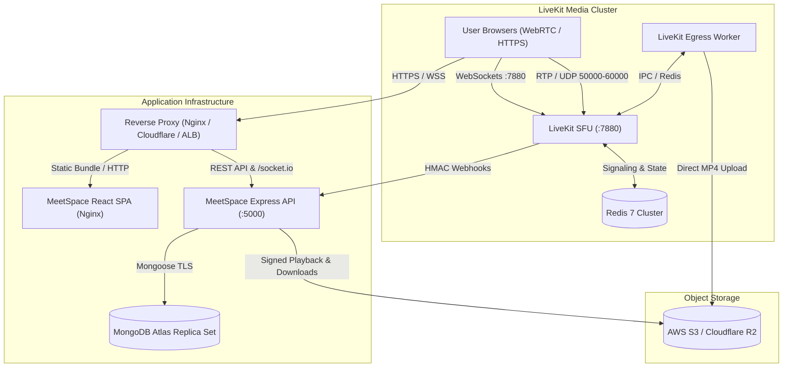

# MeetSpace — Production Deployment & Operations Guide

This guide details the deployment architecture, infrastructure requirements, security configuration, and operational procedures for hosting **MeetSpace** in a high-availability production environment.

---

## 1. Production Architecture Topology



---

## 2. Infrastructure Sizing & Firewall Requirements

### Minimum Recommended Production Specs

| Component | Minimum Specification | Recommended Production | Role |
|-----------|----------------------|------------------------|------|
| **Backend API** | 2 vCPU, 4GB RAM | 4 vCPU, 8GB RAM | REST API, Socket.IO, Auth, JWT |
| **Frontend** | 1 vCPU, 1GB RAM | 2 vCPU, 2GB RAM | Nginx static asset serving & caching |
| **LiveKit SFU** | 4 vCPU, 8GB RAM, 1Gbps NIC | 8 vCPU, 16GB RAM, 10Gbps NIC | WebRTC Selective Forwarding Unit |
| **LiveKit Egress** | 4 vCPU, 8GB RAM | 8 vCPU, 16GB RAM | Headless Chromium & GStreamer composite |
| **MongoDB** | Atlas M10 (2 vCPU, 2GB RAM) | Atlas M30 (4 vCPU, 8GB RAM) | Persistent metadata & participant presence |
| **Redis** | 1 vCPU, 2GB RAM | 2 vCPU, 4GB RAM | Pub/Sub signaling & room routing |

### Firewall & Port Ingress Matrix

| Protocol | Port / Range | Source | Purpose |
|----------|-------------|--------|---------|
| **TCP** | `80`, `443` | `0.0.0.0/0` (Public) | HTTPS Web Client & REST API traffic |
| **TCP** | `7880` | `0.0.0.0/0` (Public) | LiveKit SFU WebSocket signaling & HTTP API |
| **TCP** | `7881` | `0.0.0.0/0` (Public) | WebRTC TCP fallback (firewalled corporate clients) |
| **UDP** | `7882` | `0.0.0.0/0` (Public) | WebRTC UDP multiplexed traffic |
| **UDP** | `50000–60000` | `0.0.0.0/0` (Public) | WebRTC ICE / RTP audio & video media streams |
| **TCP** | `6379` | Internal VPC only | Redis signaling coordination |
| **TCP** | `27017` | Internal VPC / Atlas IP whitelist | MongoDB secure TLS connections |

---

## 3. Step-by-Step Production Deployment

### Step 1: Environment Variables Setup
Create `backend/.env` with production-grade secrets:
```bash
NODE_ENV=production
PORT=5000
MONGODB_URI=mongodb+srv://<user>:<password>@cluster0.mongodb.net/meetspace_prod?retryWrites=true&w=majority
JWT_ACCESS_SECRET=<generated-64-character-random-hex-string>
JWT_REFRESH_SECRET=<generated-64-character-random-hex-string>
JWT_ACCESS_EXPIRES_IN=15m
JWT_REFRESH_EXPIRES_IN=7d
FRONTEND_URL=https://meetspace.yourdomain.com
LIVEKIT_URL=wss://livekit.yourdomain.com
LIVEKIT_API_KEY=<secure-livekit-production-key>
LIVEKIT_API_SECRET=<secure-livekit-production-secret-64-chars>
MOCK_EGRESS=false
EGRESS_STORAGE_TYPE=s3
EGRESS_S3_KEY=<aws-access-key-id>
EGRESS_S3_SECRET=<aws-secret-access-key>
EGRESS_S3_BUCKET=meetspace-recordings-production
EGRESS_S3_REGION=us-east-1
```

> **Security Rule**: `validateRequiredEnv()` automatically aborts startup if `MOCK_EGRESS=true`, if development keys (`devkey`, `secret`) are supplied, or if JWT secrets are shorter than 32 characters.

### Step 2: LiveKit SFU Configuration (`livekit.prod.yaml`)
Ensure `external_ip` is configured with the public IPv4 of the media node:
```yaml
port: 7880
rtc:
  udp_port: 7882
  tcp_port: 7881
  port_range_start: 50000
  port_range_end: 60000
  use_external_ip: true
keys:
  <LIVEKIT_API_KEY>: "<LIVEKIT_API_SECRET>"
redis:
  address: "redis:6379"
webhook:
  api_key: "<LIVEKIT_API_KEY>"
  urls:
    - "http://backend:5000/api/livekit/webhooks"
```

### Step 3: Deploying with Docker Compose
```bash
# Build and start all services in detached mode
docker compose -f docker-compose.prod.yml up -d --build

# Verify container health
docker compose -f docker-compose.prod.yml ps
```

---

## 4. LiveKit Egress Worker Production Considerations

LiveKit Egress renders meeting room video layouts using a headless Linux container containing Chromium, PulseAudio, and GStreamer.

1. **Hardware Allocation**:
   - Each active room composite recording consumes **2 to 3 CPU cores** and **2.5GB to 3GB RAM**.
   - If recording 5 concurrent meetings, provision an instance with at least **16 vCPUs and 32GB RAM**.
2. **Direct Cloud Storage Upload**:
   - Avoid storing recordings on local ephemeral container volumes in production.
   - Configure AWS S3 bucket with Lifecycle Policies (e.g., transition MP4s to S3 Glacier Flexible Retrieval after 90 days).
3. **Webhook Verification**:
   - MeetSpace's `/api/livekit/webhooks` endpoint authenticates every inbound LiveKit lifecycle event via SHA-256 HMAC signature verification (`WebhookReceiver`).
   - The webhook updates database status to `completed` and records `duration` and `fileSize` only after Egress finalizes file transmission.

---

## 5. Reliability, Backups & Disaster Recovery

### MongoDB Database Backups
- Enable continuous automated point-in-time restore (PITR) in MongoDB Atlas.
- For self-hosted instances, schedule hourly automated dumps:
  ```bash
  mongodump --uri="$MONGODB_URI" --gzip --archive=/backups/meetspace_$(date +%Y%m%d_%H%M%S).gz
  ```

### Health Probes & Monitoring
MeetSpace exposes standardized health probes for Kubernetes and cloud load balancers:
- **Liveness Probe**: `GET /api/health/live` (Returns HTTP 200 if Node.js process is active).
- **Readiness Probe**: `GET /api/health/ready` (Returns HTTP 200 if MongoDB is connected; returns HTTP 503 if database connection is down).
- **Service Summary**: `GET /api/health` (Uptime and service status).

---

## 6. Scaling Constraints & Capacity Guidelines

1. **Meeting Size**:
   - LiveKit SFU comfortably supports 50-100 participants per room with adaptive simulcast.
   - For larger broadcast rooms (100-500 participants), configure LiveKit with `dynacast: true` and publish lower-resolution video tracks (360p / 180p) to inactive grid tiles.
2. **Socket.IO Scalability**:
   - When running multiple backend API instances behind a load balancer, configure the `@socket.io/redis-adapter` so Socket.IO events broadcast seamlessly across all backend instances.
